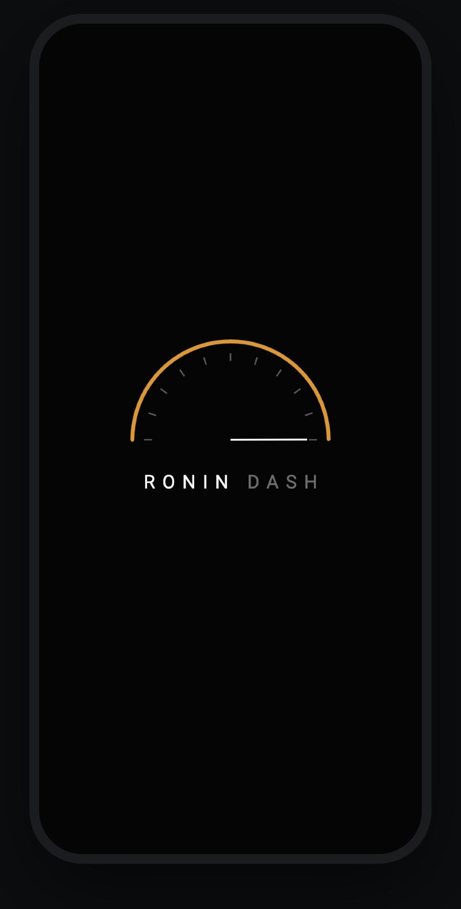
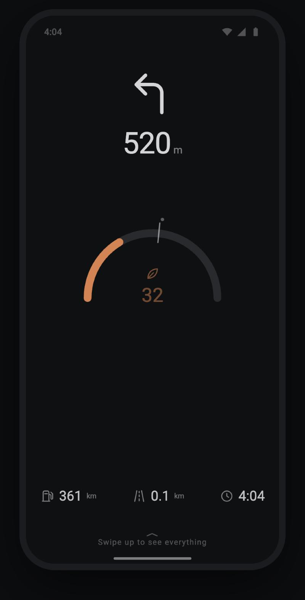
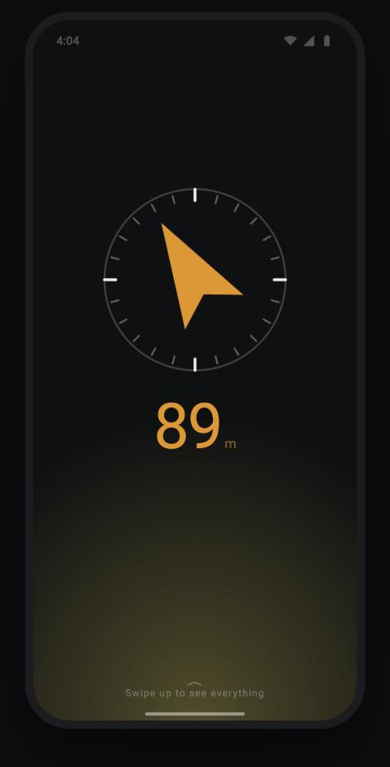
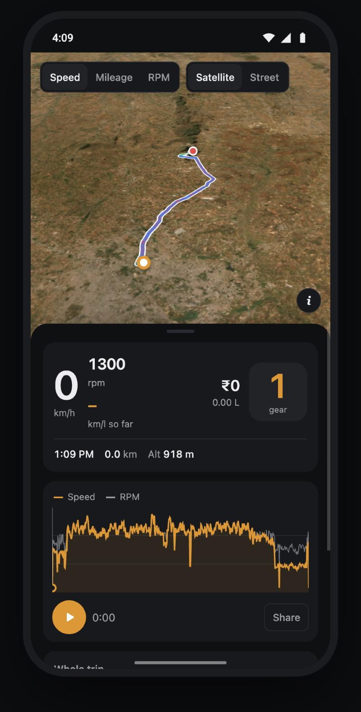

# Ronin Dash

An open-source Android companion app for the **TVS Ronin** motorcycle (2024 SE, cluster type U368). It replaces the
official connected-vehicle app.

<p align="center">
  
  
  
  
  
  
</p>
<p align="center"><sub>Opening · Dashboard · Riding · Fast mode · Trips · Trip map. Screens from the design mock-up, demo ride Hebbal → Nandi Hills.</sub></p>

<p align="center"><b><a href="https://github.com/mohammed-Araf/TVS-Ronin-App/releases/latest">⬇ Download the APK</a></b> · Android 12 or newer · <a href="https://t.me/RoninDashApp">Telegram group</a></p>

> **Unofficial.** This project is not affiliated with, endorsed by, or connected to TVS Motor Company. "TVS" and "Ronin"
> are their trademarks and are used only to say which motorcycle this works with. No TVS code, logos or assets are included.

> **Ride safely.** Don't look at or touch your phone while riding. Ronin Dash is designed to need no attention: it uses
> sounds in the helmet and the bike's own display. You are still responsible for how you use it. This is experimental
> software, so test it with the bike parked first. Crash detection and SOS are best-effort and must not be your only safety measure.

## Why

The official app is unreliable on this bike:

- The I button often does nothing.
- The voice assistant starts by itself.
- Missed-call counts show garbage like "99".
- The fuel reading is wrong.

Ronin Dash talks to the cluster directly over Bluetooth LE using a protocol documented from scratch
([docs/protocol.md](docs/protocol.md)). It fixes those problems and keeps the app out of the way.

## Features

| | |
|---|---|
| **Connection** | Connects by itself when the ignition turns on, like an intercom. Nothing runs while the bike is off |
| **Calls** | Caller name on the cluster. Answer or reject with the I button |
| **Assistant** | Hold the I button for 2–3 s to open the phone's voice assistant. Assistants can change only display brightness |
| **Live data** | Speed, RPM, gear, throttle, fuel gauge (in bars, as the bike sends it), temperatures, battery, warnings |
| **Display brightness** | 20–100 %, set automatically from ambient light when the phone is mounted, or by hand |
| **Trips** | Trip log with distance, fuel estimate and route map |
| **Safety** | Side-stand-down-while-moving alert. Crash detection with an SOS countdown *(experimental)* |
| **Audio** | Short earcons and optional spoken cues ([Kokoro-82M](https://huggingface.co/hexgrad/Kokoro-82M) voice, offline) |

## Roadmap

### ✅ Done

- **Protocol decoded:**
  - transport, XOR encoding and checksum
  - all bike → phone frame types
  - phone → bike status, text, caller, navigation and settings frames
- **Verified on the bike:**
  - speed, RPM, gear, telltales, clutch and side stand
  - I button and Mode events, with exact press timing
  - call accept and reject
  - display brightness write and readback
  - ride mode readback
  - fuel gauge bars
- **Android app (0.5):**
  - auto-connect background service
  - redesigned dashboard, riding and fast-mode screens (the 31 changes from the browser mock-up)
  - missed calls and unread messages at the top of the app, and their counts sent to the cluster
  - I button: hold 2–3 s for the phone's assistant or the Gemini app (your choice in Settings)
  - overspeed: your limit is sent to the cluster's own warning, plus a ping in the helmet
  - Google Maps turns: distance and left/right sent to the cluster, tones in the helmet
  - fuel and range that learn the bike from its own fuel gauge, no logging needed
  - display brightness on the dashboard (auto or slider), engine warm-up indicator
  - trip recording with a 3D route map, crash detection, guided bike-test screen and debug logging
- **Official-app bugs found and avoided:**
  - assistant auto-wake
  - call-button matching
  - fuel read as a percentage
  - caller-frame flooding linked to the "99" count
- **Sound design:** earcon pack, voice clips and an engine-start sound recorded from a real Ronin.

### 🚧 In progress

- A full real-world ride with Ronin Dash as the only app.
- Confirming on the bike: unread counts (the "99" fix), the overspeed warning and turn distances on the cluster.

### 🔭 Next big things (ideas welcome)

- **Any navigation app:** turn arrows and distance from Google Maps, Waze, HERE WeGo, Organic Maps, OsmAnd and others,
  not just Google Maps.
- **Music:** play, pause, skip and volume for Spotify, YouTube Music or any player.
- **More assistants:** ChatGPT, Alexa or any other assistant app on the I button (today: the phone's assistant or Gemini).
- **Riding-safe controls.** The bike has one I button that sends one signal, so music and volume need another way that is
  easy with gloves and never needs a look at the phone. Options being explored:
  - press patterns on the I and Mode buttons (double press, press-and-hold)
  - the helmet intercom's own buttons
  - a small Bluetooth remote on the handlebar
  - volume that follows speed, louder as wind noise rises
  - voice commands through your assistant

### 📋 Planned

- [ ] Full turn arrows on the cluster (roundabouts, keep left/right, exits): map the remaining pictogram ids (§7 of the protocol).
- [ ] Faster recovery when call audio on an intercom drops the bike link.
- [ ] Signed release builds.

## Repository layout

| Path | Contents |
|---|---|
| `android/` | The app (Kotlin, Jetpack Compose) |
| `docs/protocol.md` | The cluster's BLE protocol |
| `tools/ronin_test.py` | BLE test console for a Mac: send and decode frames |
| `tools/btsnoop_parse.py` | Extracts cluster frames from an Android HCI snoop log |
| `tools/data_guard.py` | Plausibility filter for decoded values, with a glitch-injection test |
| `tools/make_sounds.py`, `tools/make_voice.py` | Generate the earcons (`tools/sounds/`) and voice clips (`tools/voice/`) |

## Building

Requires JDK 17 and the Android SDK.

```bash
cd android && ./gradlew assembleDebug
```

The APK is written to `android/app/build/outputs/apk/debug/`. On first launch, pair the bike in Android's Bluetooth
settings using the passkey shown on the cluster. Then choose it in **Settings**.

## Support the project

Ronin Dash is free, with no ads and no tracking, and is built in spare time. If it makes your rides better, you can
support it by UPI:


UPI ID: **alancruse@airtel**

Bug reports and ideas help just as much: [open an issue](https://github.com/mohammed-Araf/TVS-Ronin-App/issues/new/choose), or chat in the [Telegram group](https://t.me/RoninDashApp).

## Credits

Voice clips: [Kokoro-82M](https://huggingface.co/hexgrad/Kokoro-82M) (Apache-2.0).

## Licence

Ronin Dash is free software under the [GNU General Public License v3.0](LICENSE). You may use, study, share and change
it. If you publish a modified version, or an app built on this code, you must release its full source code under the
same licence, so nobody can turn it into a closed app. Anyone who sells a copy must also give its buyers the source code
and the right to share it for free.

**Commercial licence.** If you want to use this code in a closed-source or commercial product, contact the author
through [GitHub](https://github.com/mohammed-Araf) for a separate paid licence.

Copyright © 2026 mohammed-Araf.
