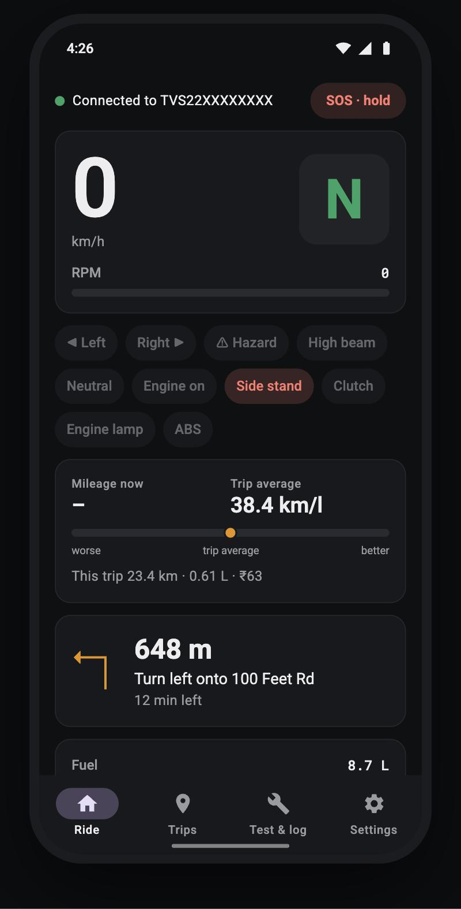
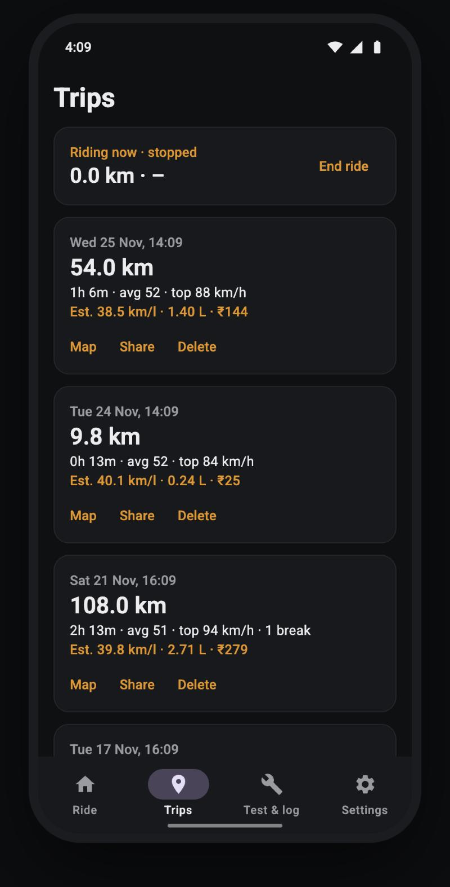
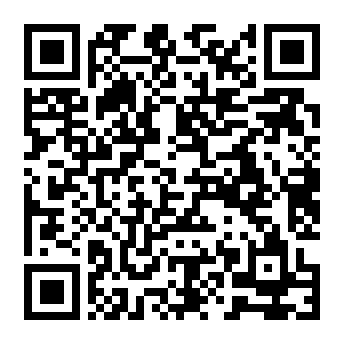

# Ronin Dash

An open-source Android companion app for the **TVS Ronin** motorcycle (2024 SE, cluster type U368). It replaces the
official connected-vehicle app: it talks to the bike's cluster directly over Bluetooth LE, connects by itself when you
turn the key, and is built to need no attention while you ride.

<p align="center">
  
  
  
  
  
  
</p>
<p align="center"><sub>Opening · Dashboard · Riding · Fast mode · Trips · Trip map. Screens from the design mock-up, demo ride Hebbal → Nandi Hills.</sub></p>

<p align="center"><b><a href="https://github.com/mohammed-Araf/TVS-Ronin-App/releases/latest">⬇ Download the APK</a></b> · Android 12 or newer · <a href="https://t.me/RoninDashApp">Telegram group</a></p>

> **Unofficial.** This project is not affiliated with, endorsed by, or connected to TVS Motor Company. "TVS" and "Ronin"
> are their trademarks and are used only to say which motorcycle this works with. No TVS code, logos or assets are included.

> **Ride safely.** Don't look at or touch your phone while riding. Ronin Dash is designed to need no attention: it uses
> sounds in the helmet, the handlebar buttons and the bike's own display. You are still responsible for how you use it.
> This is experimental software, so test it with the bike parked first. Crash detection and SOS are best-effort and must
> not be your only safety measure.

## Contents

- [Why](#why)
- [Features](#features)
- [Handlebar buttons](#handlebar-buttons)
- [Getting started](#getting-started)
- [Testing and reporting issues](#testing-and-reporting-issues)
- [Privacy](#privacy)
- [Roadmap](#roadmap)
- [Building from source](#building-from-source)
- [Repository layout](#repository-layout)
- [Contributing](#contributing)
- [Support the project](#support-the-project)
- [Licence](#licence)

## Why

The official app is unreliable on this bike:

- The I button often does nothing, or needs to be pressed again and again.
- The voice assistant starts by itself when the bike connects.
- Missed-call counts show garbage like "99".
- The fuel reading is wrong: the bike sends fuel **bars**, and the official app shows them as a percentage ("9 %, low fuel"
  on a full tank).
- Calls, SMS and maps are flaky.

Ronin Dash talks to the cluster directly using a protocol documented from scratch ([docs/protocol.md](docs/protocol.md)).
It avoids those bugs and keeps the app out of your way.

## Features

### On the bike

| | |
|---|---|
| **Connection** | Connects by itself when the ignition turns on, like a helmet intercom. Nothing runs while the bike is off (0 MB, no battery use) |
| **Calls** | Caller name on the cluster straight away (the official app is ~4.5 s late). Answer or reject with the I button. Real missed-call counts, without the "99" bug |
| **Messages** | Unread SMS / chat counts on the cluster, sender name for SMS |
| **Navigation** | Google Maps turns on the cluster: arrow and distance counting down. Left/right tones in the matching ear of the helmet |
| **Assistant** | Hold the I button to open the phone's assistant, or the Gemini app (your choice) |
| **Handlebar buttons** | Starter, Mode and I button presses can skip songs, change volume, open the map, show the dashboard or call the assistant. [Details below](#handlebar-buttons) |
| **Display brightness** | 20–100 %, set automatically from the phone's light sensor when it's on the mount, or by hand |
| **Overspeed** | Your speed limit is sent to the cluster's own warning, plus two pings in the helmet |

### On the phone

| | |
|---|---|
| **Riding screens** | Three automatic screens (parked, riding, fast ≥ 70 km/h), each in day and night style. The bike picks the screen, never a button. Nothing the cluster already shows is repeated |
| **Night panel** | A dim, glanceable panel from sunset to sunrise: mileage or speed, next-turn compass, colour of your choice |
| **Live data** | Speed, RPM, gear, throttle, fuel gauge in bars, engine and intake temperature, battery voltage, warning lamps |
| **Fuel and range** | A fuel model that learns your bike from its own fuel gauge and your fill-ups. Range uses your mileage over the last ~50 km, not the bike's guess |
| **Trips** | Automatic trip log with distance, time, fuel used and cost, and a 3D route map. Share card for a trip |
| **Engine warm-up** | Shows how warm the engine is after a cold start, and a sound when it's ready |
| **Service reminder** | One notification when the next service is close. The only notification the app ever posts |
| **Calls while riding fast** | Optionally holds call and message alerts while you're fast, and gives them to you when you slow down |
| **Safety** | Side-stand-down-while-moving alarm. Crash detection with an SOS countdown that can send your location by SMS or call *(experimental)* |
| **Sounds** | Short earcons instead of sentences (indicator tick-tock, turn tones, warnings). Optional offline voice ([Kokoro-82M](https://huggingface.co/hexgrad/Kokoro-82M)) for emergencies. Engine-start sound recorded from a real Ronin |
| **Test & log** | Guided bike test, live button lamps, a log of everything the bike sends, and **Issues**: notes you write after a ride, matched to the ride's log. [Details below](#testing-and-reporting-issues) |
| **Appearance** | Light, dark or system theme, six accent colours |

## Handlebar buttons

The Ronin has no music or volume buttons, so Ronin Dash gives extra jobs to the buttons it already has. **What each button
normally does never changes:** one Mode press still changes the ride mode, and during a call the I button still answers
and rejects.

| Button | Press | Default action | When it works |
|---|---|---|---|
| **Starter** | one press | Next song | Engine running for 5 s or more |
| **Starter** | two presses | Previous song | Engine running for 5 s or more |
| **Starter** | hold 1½ s | Play / pause | Engine running for 5 s or more |
| **Mode** | double press | Show the map | Engine on. The mode flips and back (Urban → Rain → Urban), so you end up in the same mode |
| **Mode** | hold | Show the dashboard | Engine on |
| **I** | hold 2–3 s, then let go | Assistant | No call ringing |

Every press can be changed in **Settings → Handlebar buttons** to any of these:

- Next song / Previous song / Play or pause (works with Spotify, YouTube Music or any player)
- Volume up / Volume down / Mute or unmute
- Show the map (brings Google Maps to the front, straight back into navigation if it's running)
- Show the dashboard
- Assistant (the phone's assistant or Gemini)
- Nothing

No extra press works during a call or a crash alert. Settings also has **Try** buttons to check each action while the bike
is connected.

**Why the starter is free:** TVS starts the engine with an integrated starter-generator, and the ECU ignores the starter
button once the engine is running. So while riding, the button does nothing on the bike, and the app can use it. The
app only counts presses 5 seconds after the engine started, so starting the bike is never read as a gesture.

> **Status:** the button gestures are new and not tested on the bike yet. The bike reports its buttons a few times a
> second, so a very quick tap can be missed; press firmly. Test & log shows a lamp for each button so you can see whether
> the app reads it.

## Getting started

1. **Install the APK** from the [latest release](https://github.com/mohammed-Araf/TVS-Ronin-App/releases/latest).
   Android 12 or newer.
   - *Xiaomi / Redmi / POCO (MIUI, HyperOS):* if the installer refuses, copy the APK to the phone's **Download** folder
     and open it from Xiaomi's own **File Manager** app.
2. **Close the official app** (Settings → Apps → TVS Connect → Force stop), or uninstall it. Two apps can't talk to the
   cluster at once.
3. **Pair the bike.** Ignition on. On the cluster, long-press Mode → *Clock setting* → press Mode once → *BT pairing*. The
   cluster shows a 6-digit passkey: enter it when Android asks.
4. **Open Ronin Dash** and follow the one-screen setup. Allow Android's "access your bike" dialog: that's what lets the app
   wake up by itself when the bike turns on and stop when it turns off.
5. **Grant the permissions** in Settings → Permissions (phone, contacts, notifications for Maps, location for trips, display over
   other apps for the assistant and map).
6. Optional: set your name, speed limit, tank size, fuel price, service interval, SOS contacts and button actions in **Settings**.

From then on, turn the key and ride. The app connects, works in the background, and stops when you switch off.

## Testing and reporting issues

The **Test & log** tab has two parts.

**Tests**
- Live lamps for Starter (with a press count), Mode, I, Clutch and Engine, and the last button action.
- A step-by-step bike test: connection, I button, cluster text, caller, SMS, navigation arrows, calls and the new handlebar
  button gestures. Your answers are saved in the ride log.
- Every frame the bike sends, and everything the app sends, is logged to
  `Android/data/dev.ronindash/files/logs/ride_*.csv`.

**Issues**
Write down each problem as soon as you stop, so nothing is forgotten on the way home. Each note is saved with the time
you wrote it, roughly when it happened ("5 min ago", "30 min", …), and the ride log that covers that moment. Notes
written while the bike is still connected also go into the ride log itself.

To hand them to a developer (or to work through them yourself), connect the phone by USB and pull both folders:

```bash
adb pull /sdcard/Android/data/dev.ronindash/files/notes/ notes/
```
```bash
adb pull /sdcard/Android/data/dev.ronindash/files/logs/ logs/
```

`notes/ISSUES.md` is the readable list; `notes/notes.jsonl` has one note per line with the exact times and the log file
name, so each note points straight to the lines in the log where it happened.

Bug reports are welcome on [GitHub](https://github.com/mohammed-Araf/TVS-Ronin-App/issues/new/choose) or in the
[Telegram group](https://t.me/RoninDashApp). Attaching the ride log and your Issues notes helps a lot.

## Privacy

- No account, no ads, no analytics, no tracking.
- Everything stays on your phone: trips, logs, notes and settings. Nothing is uploaded.
- The only network use is map tiles for the trip map. SOS sends an SMS or makes a call only to the contacts you set.
- Assistants (Gemini, Google Assistant, Tasker…) can change **only** the bike display brightness. No data, calls, messages
  or settings are exposed to other apps.

## Roadmap

### ✅ Done

- **Protocol decoded:**
  - transport, XOR encoding and checksum
  - all bike → phone frame types
  - phone → bike status, text, caller, navigation and settings frames
- **Verified on the bike:**
  - speed, RPM, gear, telltales, clutch and side stand
  - I button and Mode events, with exact press timing
  - call accept and reject
  - display brightness write and readback
  - ride mode readback
  - fuel gauge bars
- **Android app (0.5):**
  - auto-connect background service
  - redesigned dashboard, riding and fast-mode screens (the 31 changes from the browser mock-up)
  - missed calls and unread messages at the top of the app, and their counts sent to the cluster
  - I button: hold 2–3 s for the phone's assistant or the Gemini app (your choice in Settings)
  - overspeed: your limit is sent to the cluster's own warning, plus a ping in the helmet
  - Google Maps turns: distance and left/right sent to the cluster, tones in the helmet
  - fuel and range that learn the bike from its own fuel gauge, no logging needed
  - display brightness on the dashboard (auto or slider), engine warm-up indicator
  - trip recording with a 3D route map, crash detection, guided bike-test screen and debug logging
- **Version 0.6:**
  - handlebar button actions: starter single/double/hold, Mode double/hold and I hold, each customisable (music, volume,
    map, dashboard, assistant)
  - live button lamps in Test & log
  - Issues notes written after a ride, matched to the ride log and readable over USB
- **Official-app bugs found and avoided:**
  - assistant auto-wake
  - call-button matching
  - fuel read as a percentage
  - caller-frame flooding linked to the "99" count
- **Sound design:** earcon pack, voice clips and an engine-start sound recorded from a real Ronin.

### 🚧 In progress

- A full real-world ride with Ronin Dash as the only app.
- Confirming on the bike: the handlebar button gestures (does the app read the starter while riding? how quick can a tap
  be?), unread counts (the "99" fix), the overspeed warning and turn distances on the cluster.

### 🔭 Next big things (ideas welcome)

- **Any navigation app:** turn arrows and distance from Google Maps, Waze, HERE WeGo, Organic Maps, OsmAnd and others,
  not just Google Maps.
- **More assistants:** ChatGPT, Alexa or any other assistant app on the I button (today: the phone's assistant or Gemini).
- **More riding-safe controls:**
  - the helmet intercom's own buttons
  - a small Bluetooth remote on the handlebar
  - volume that follows speed, louder as wind noise rises
  - voice commands through your assistant

### 📋 Planned

- [ ] Full turn arrows on the cluster (roundabouts, keep left/right, exits): map the remaining pictogram ids (§7 of the protocol).
- [ ] Faster recovery when call audio on an intercom drops the bike link.
- [ ] Tune button-gesture timing from real ride logs.
- [ ] Signed release builds.

## Building from source

Requires JDK 17 and the Android SDK (compile SDK 36).

```bash
cd android && ./gradlew assembleDebug
```

The APK is written to `android/app/build/outputs/apk/debug/`. Unit tests (data guard, fuel model, fuel gauge, button
gestures):

```bash
cd android && ./gradlew testDebugUnitTest
```

Debug builds include an adb-only receiver for bench tests without riding, e.g.
`adb shell am broadcast -n dev.ronindash/.DebugReceiver --ei bright 5`, and log everything to logcat under the tag
`RoninDash`.

## Repository layout

| Path | Contents |
|---|---|
| `android/` | The app (Kotlin, Jetpack Compose, no third-party libraries beyond AndroidX) |
| `android/app/src/main/java/dev/ronindash/` | `BikeService` (connection, calls, nav, buttons), `Protocol` (frames), `Buttons` (gestures), `Fuel` / `FuelLearner`, `Trip`, `Crash`, `Notes`, and the screens |
| `docs/protocol.md` | The cluster's BLE protocol |
| `tools/ronin_test.py` | BLE test console for a Mac: send and decode frames |
| `tools/btsnoop_parse.py` | Extracts cluster frames from an Android HCI snoop log |
| `tools/data_guard.py` | Plausibility filter for decoded values, with a glitch-injection test |
| `tools/make_sounds.py`, `tools/make_voice.py` | Generate the earcons (`tools/sounds/`) and voice clips (`tools/voice/`) |
| `tools/make_engine.py`, `tools/clean_engine.py`, `tools/engine_variants.py` | Build the engine-start sound from a real Ronin recording |

## Contributing

Ronin owners are the most useful contributors: ride with it, write down what goes wrong in **Test & log → Issues**, and
open an issue with the ride log. Owners of other TVS bikes with a connected cluster are welcome to try it and share logs;
the protocol may be close.

For code: keep the riding rules in mind. Sounds over sentences, icons over text, nothing that needs a look at the phone,
and never repeat what the cluster already shows.

## Support the project

Ronin Dash is free, with no ads and no tracking, and is built in spare time. If it makes your rides better, you can
support it by UPI:



UPI ID: **alancruse@airtel**

Bug reports and ideas help just as much: [open an issue](https://github.com/mohammed-Araf/TVS-Ronin-App/issues/new/choose), or chat in the [Telegram group](https://t.me/RoninDashApp).

## Credits

Voice clips: [Kokoro-82M](https://huggingface.co/hexgrad/Kokoro-82M) (Apache-2.0).

## Licence

Ronin Dash is free software under the [GNU General Public License v3.0](LICENSE). You may use, study, share and change
it. If you publish a modified version, or an app built on this code, you must release its full source code under the
same licence, so nobody can turn it into a closed app. Anyone who sells a copy must also give its buyers the source code
and the right to share it for free.

**Commercial licence.** If you want to use this code in a closed-source or commercial product, contact the author
through [GitHub](https://github.com/mohammed-Araf) for a separate paid licence.

Copyright © 2026 mohammed-Araf.
